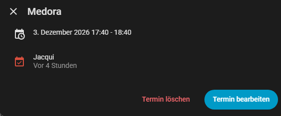
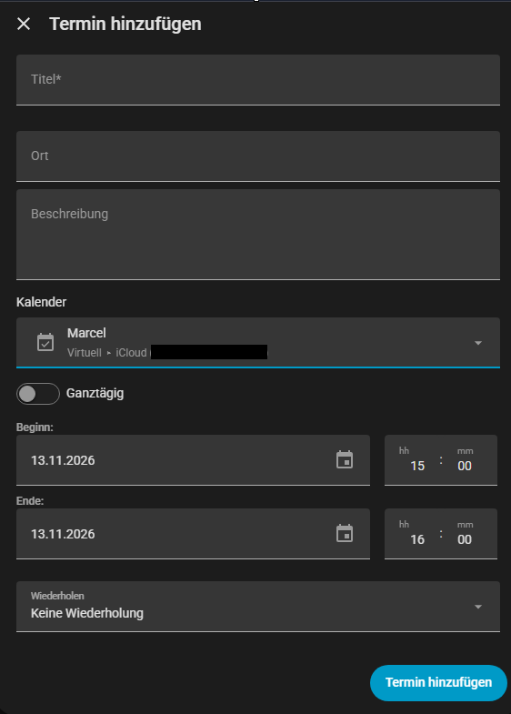
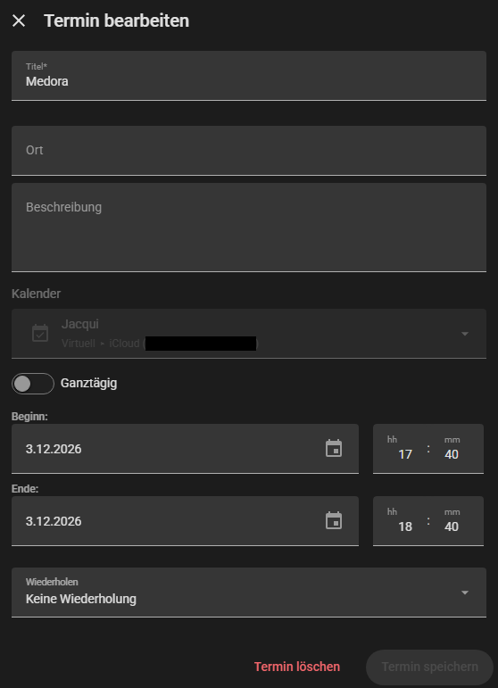
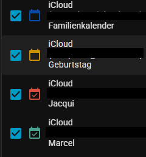

# Calendar Sync (Google & iCloud) for Home Assistant

[](https://github.com/Caps3n/hass-calendar-sync/releases)
[](https://github.com/hacs/integration)
[](https://www.home-assistant.io/)
[](LICENSE)
[](https://github.com/Caps3n/hass-calendar-sync/actions/workflows/validate.yml)
[](https://www.buymeacoffee.com/caps3n)

🇩🇪 [Deutsche Anleitung](README_DE.md)

Calendar entities you can **create, edit and delete events** in, right inside Home Assistant. Every change is written straight to your Google Calendar or Apple iCloud calendar.

<p>
  
</p>

## ✨ Features

- 🍏 **Apple iCloud** (and any other CalDAV server, e.g. Nextcloud)
- 📅 **Google Calendar** (OAuth)
- ✏️ Create, edit and delete events from the Home Assistant calendar dashboard
- 🔁 Recurring events: change or delete a single occurrence or "this and all following"
- 🤖 Services for automations: `calendar_sync.list_events`, `calendar_sync.update_event`, `calendar_sync.delete_event`
- 🔒 Read-only calendars (e.g. holidays) are shown but not editable
- 🌍 English and German

| Add event | Edit event | Your calendars |
| --- | --- | --- |
|  |  |  |

**Requirements:** Home Assistant **2025.2** or newer.

## 📦 Installation

### HACS (recommended)

[](https://my.home-assistant.io/redirect/hacs_repository/?owner=Caps3n&repository=hass-calendar-sync&category=integration)

1. HACS → ⋮ (top right) → *Custom repositories* → add `https://github.com/Caps3n/hass-calendar-sync` as type *Integration*.
2. Install **Calendar Sync (Google & iCloud)**.
3. Restart Home Assistant.

### Manual

Copy `custom_components/calendar_sync` to `/config/custom_components/calendar_sync` and restart Home Assistant.

## ⚙️ Setup

[](https://my.home-assistant.io/redirect/config_flow_start/?domain=calendar_sync)

### Apple iCloud

1. At [account.apple.com](https://account.apple.com) → *Sign-In and Security* → *App-Specific Passwords*, create a new password (e.g. "Home Assistant").
2. In Home Assistant: *Settings → Devices & services → Add integration → Calendar Sync* → **Apple iCloud / CalDAV**.
3. Keep the URL `https://caldav.icloud.com/`, enter your Apple ID and the app-specific password.
4. Pick your calendars. Done.

### Google Calendar

Google requires your own OAuth client (one-time, free):

1. Create a project in the [Google Cloud Console](https://console.cloud.google.com/).
2. *APIs & Services → Library* → enable the **Google Calendar API**.
3. *OAuth consent screen*: type *External*, add your Google address as a test user. Then set it to **"In production"**, otherwise the sign-in expires after 7 days. Google review is not needed for personal use; just click through the warning when signing in.
4. *Credentials → Create OAuth client ID* → type **Web application**, redirect URI `https://my.home-assistant.io/redirect/oauth`.
5. In Home Assistant: *Add integration → Calendar Sync* → **Google Calendar**, enter client ID and secret, sign in with Google, pick your calendars.

> Tip: if you used the official *Google Calendar* or *CalDAV* integrations for the same calendars before, remove them to avoid duplicate entities.

## 🚀 Usage

**Dashboard:** open *Calendar* in the sidebar, click an event → *Edit* or *Delete*. New events via *Add event*.

**Automations:**

```yaml
# Create an event (built-in Home Assistant action)
action: calendar.create_event
target:
  entity_id: calendar.icloud_private
data:
  summary: Take out the trash
  start_date_time: "2026-11-20 19:00:00"
  end_date_time: "2026-11-20 19:15:00"

# List events including their UID
action: calendar_sync.list_events
target:
  entity_id: calendar.icloud_private
data:
  start: "2026-11-20 00:00:00"
  end: "2026-11-27 00:00:00"
response_variable: events

# Change an event (fields you leave out stay the same)
action: calendar_sync.update_event
target:
  entity_id: calendar.icloud_private
data:
  uid: "{{ events['calendar.icloud_private'].events[0].uid }}"
  summary: Take out the trash (yellow bin)

# Delete an event
action: calendar_sync.delete_event
target:
  entity_id: calendar.icloud_private
data:
  uid: "{{ events['calendar.icloud_private'].events[0].uid }}"
```

For recurring events also pass `recurrence_id` from `list_events`. Without `recurrence_range` only that occurrence changes; with `recurrence_range: THISANDFUTURE` that occurrence and all following ones.

## ℹ️ Good to know

- Events are refreshed every 5 minutes, and right after every change made in Home Assistant.
- New timed events are stored in UTC and shown in your time zone by every calendar app.
- Google and Apple are **not** synced with each other: each event stays in the calendar it belongs to.
- Moving an event to a different calendar is not supported yet.

## 🛠️ Development

```bash
pip install pytest-homeassistant-custom-component "caldav==2.1.0" "icalendar==6.3.1"
pytest
```

## 👥 Credits

Developed by [@Caps3n](https://github.com/Caps3n) together with [Claude](https://claude.ai) (Anthropic).

If this integration is useful to you, I'd appreciate a coffee:

<a href="https://www.buymeacoffee.com/caps3n" target="_blank"></a>

## 📄 License

[MIT](LICENSE)
