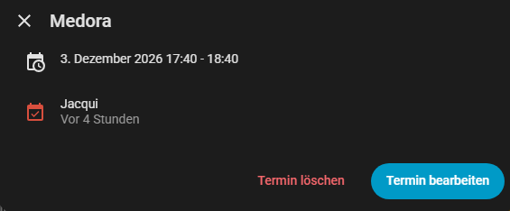
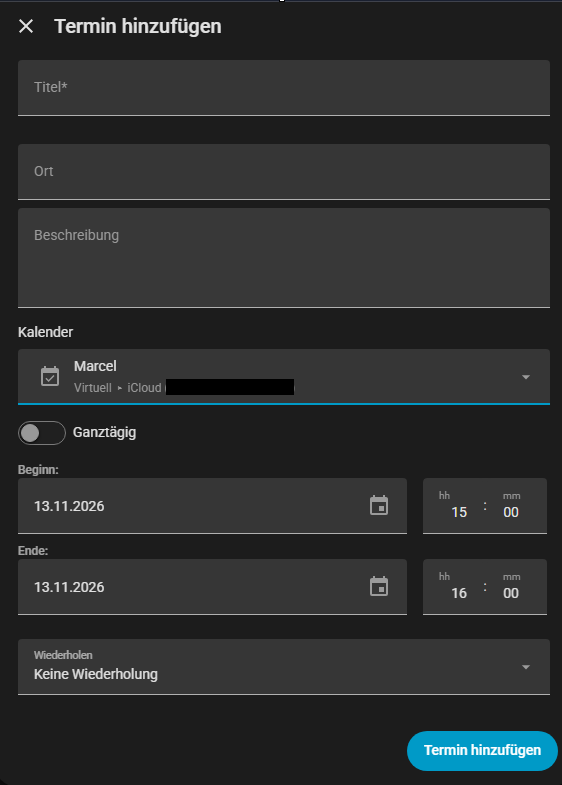
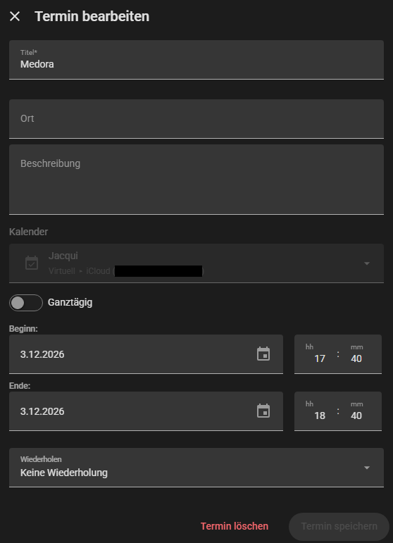
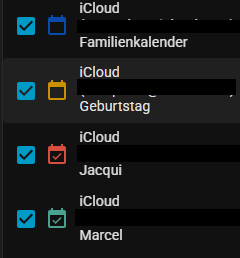

# Calendar Sync (Google & iCloud) für Home Assistant

[](https://github.com/Caps3n/hass-calendar-sync/releases)
[](https://github.com/hacs/integration)
[](https://www.home-assistant.io/)
[](LICENSE)
[](https://www.buymeacoffee.com/caps3n)

🇬🇧 [English](README.md)

Kalender-Entitäten, in denen du Termine direkt in Home Assistant **erstellen, bearbeiten und löschen** kannst. Jede Änderung wird sofort in den Google Kalender bzw. den Apple-iCloud-Kalender geschrieben.

<p>
  
</p>

## ✨ Funktionen

- 🍏 **Apple iCloud** (und jeder andere CalDAV-Server, z. B. Nextcloud)
- 📅 **Google Kalender** (OAuth)
- ✏️ Termine im Kalender-Dashboard erstellen, bearbeiten und löschen
- 🔁 Serientermine: einzelnes Vorkommen oder „dieses und alle folgenden“ ändern oder löschen
- 🤖 Dienste für Automationen: `calendar_sync.list_events`, `calendar_sync.update_event`, `calendar_sync.delete_event`
- 🔒 Schreibgeschützte Kalender (z. B. Feiertage) werden nur angezeigt
- 🌍 Deutsch und Englisch

| Termin hinzufügen | Termin bearbeiten | Deine Kalender |
| --- | --- | --- |
|  |  |  |

**Voraussetzung:** Home Assistant **2025.2** oder neuer.

## 📦 Installation

### HACS (empfohlen)

[](https://my.home-assistant.io/redirect/hacs_repository/?owner=Caps3n&repository=hass-calendar-sync&category=integration)

1. HACS → oben rechts ⋮ → *Benutzerdefinierte Repositories* → `https://github.com/Caps3n/hass-calendar-sync` als Typ *Integration* hinzufügen.
2. **Calendar Sync (Google & iCloud)** installieren.
3. Home Assistant neu starten.

### Manuell

Den Ordner `custom_components/calendar_sync` nach `/config/custom_components/calendar_sync` kopieren und Home Assistant neu starten.

## ⚙️ Einrichtung

[](https://my.home-assistant.io/redirect/config_flow_start/?domain=calendar_sync)

### Apple iCloud

1. Auf [account.apple.com](https://account.apple.com) → *Anmeldung und Sicherheit* → *App-spezifische Passwörter* ein neues Passwort erzeugen (z. B. „Home Assistant“).
2. In HA: *Einstellungen → Geräte & Dienste → Integration hinzufügen → Calendar Sync* → **Apple iCloud / CalDAV**.
3. URL `https://caldav.icloud.com/` stehen lassen, Apple-ID als Benutzername, das app-spezifische Passwort eintragen.
4. Kalender auswählen. Fertig.

### Google Kalender

Google verlangt einen eigenen OAuth-Client (einmalig, kostenlos):

1. In der [Google Cloud Console](https://console.cloud.google.com/) ein Projekt anlegen.
2. *APIs & Dienste → Bibliothek* → **Google Calendar API** aktivieren.
3. *OAuth-Zustimmungsbildschirm*: Typ *Extern*, deine Google-Adresse als Testnutzer eintragen. Danach auf **„In Produktion“** stellen, sonst läuft die Anmeldung nach 7 Tagen ab. Eine Prüfung durch Google ist für den Eigengebrauch nicht nötig, die Warnung beim Anmelden einfach wegklicken.
4. *Anmeldedaten → OAuth-Client-ID erstellen* → Typ **Webanwendung**, Weiterleitungs-URI `https://my.home-assistant.io/redirect/oauth`.
5. In HA: *Integration hinzufügen → Calendar Sync* → **Google Calendar**, Client-ID und Client-Secret eingeben, mit Google anmelden, Kalender auswählen.

> Tipp: Wenn du vorher die offiziellen Integrationen *Google Calendar* oder *CalDAV* für dieselben Kalender genutzt hast, entferne sie, damit du keine doppelten Entitäten hast.

## 🚀 Benutzung

**Im Dashboard:** *Kalender* in der Seitenleiste öffnen, auf einen Termin klicken → *Bearbeiten* oder *Löschen*. Neuer Termin über *Termin hinzufügen*.

**In Automationen:**

```yaml
# Termin anlegen (Standard-Aktion von HA)
action: calendar.create_event
target:
  entity_id: calendar.icloud_privat
data:
  summary: Müll rausbringen
  start_date_time: "2026-11-20 19:00:00"
  end_date_time: "2026-11-20 19:15:00"

# Termine mit UID abfragen
action: calendar_sync.list_events
target:
  entity_id: calendar.icloud_privat
data:
  start: "2026-11-20 00:00:00"
  end: "2026-11-27 00:00:00"
response_variable: termine

# Termin ändern (nicht angegebene Felder bleiben gleich)
action: calendar_sync.update_event
target:
  entity_id: calendar.icloud_privat
data:
  uid: "{{ termine['calendar.icloud_privat'].events[0].uid }}"
  summary: Müll rausbringen (Gelbe Tonne)

# Termin löschen
action: calendar_sync.delete_event
target:
  entity_id: calendar.icloud_privat
data:
  uid: "{{ termine['calendar.icloud_privat'].events[0].uid }}"
```

Bei Serienterminen zusätzlich `recurrence_id` aus `list_events` mitgeben. Ohne `recurrence_range` betrifft die Änderung nur dieses Vorkommen, mit `recurrence_range: THISANDFUTURE` dieses und alle folgenden.

## ℹ️ Gut zu wissen

- Termine werden alle 5 Minuten abgefragt, nach jeder Änderung in HA sofort.
- Neue Termine mit Uhrzeit werden in UTC gespeichert und von allen Kalender-Apps korrekt in deiner Zeitzone angezeigt.
- Google und Apple werden **nicht** untereinander abgeglichen: Jeder Termin bleibt in dem Kalender, in dem er liegt.
- Termine in einen anderen Kalender verschieben geht noch nicht.

## 👥 Credits

Entwickelt von [@Caps3n](https://github.com/Caps3n) zusammen mit [Claude](https://claude.ai) (Anthropic).

Wenn dir die Integration hilft, freue ich mich über einen Kaffee:

<a href="https://www.buymeacoffee.com/caps3n" target="_blank"></a>

## 📄 Lizenz

[MIT](LICENSE)
